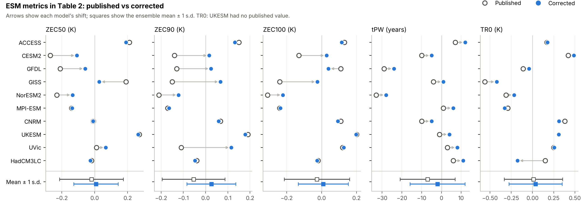

# flat10MIP ESM metrics: published vs corrected distributions

For co-authors, in particular for use in assessments. Values are the ten ESMs of Table 2. Regenerate the figure
and numbers with `python corrigendum/distribution_shifts.py`.

## Summary

The correction leaves the ensemble centres almost unchanged but narrows the ZEC spread by about a quarter. ZEC stays
centred near zero, and flat10 ZEC is now clearly smaller in magnitude than ZECMIP ZEC.

* **Centre unchanged:** the multi-model mean ZEC50 goes from −0.02 to +0.01 K, ZEC90 from −0.05 to +0.03 K and
  ZEC100 from −0.03 to +0.01 K. T100yr is unchanged (mean 1.70 K) apart from the UVic typo.
* **Spread narrower:** the ensemble standard deviation falls from 0.19 to 0.14 K (ZEC50), 0.14 to 0.11 K (ZEC90) and
  0.19 to 0.14 K (ZEC100). The ZEC50 range goes from −0.27–0.27 K to −0.14–0.26 K.
* **ZEC90 sign balance reverses:** 3 of 10 models positive before, 7 of 10 after; the median goes from −0.12 to
  +0.04 K. Four models change sign: CESM2, GFDL, GISS, and UVic (a published sign typo). This moves values from just
  below to just above zero and does not indicate a positive ensemble ZEC.
* **tPW:** every model moves 5 years later. The median goes from 2.5 years before net zero to 2.5 years after.
* **TR0:** the mean stays near 0 K (0.01 → 0.04 K), but individual values shift by up to 0.33 K; HadCM3 changes sign.

## Ensemble statistics (published → corrected)

| Metric | Mean | Median | Std. dev. | Range | Models > 0 | Per-model shift: mean / max | Sign changes |
| --- | --- | --- | --- | --- | --- | --- | --- |
| T100yr (K) | 1.70 → 1.71 | 1.67 → 1.67 | 0.35 → 0.36 | 1.18–2.50 → 1.18–2.50 | 10 → 10 | 0.01 / 0.06 | 0 |
| ZEC50 (K) | −0.02 → +0.01 | −0.02 → −0.02 | 0.19 → 0.14 | −0.27–0.27 → −0.14–0.26 | 4 → 4 | 0.07 / 0.16 | 0 |
| ZEC90 (K) | −0.05 → +0.03 | −0.12 → +0.04 | 0.14 → 0.11 | −0.21–0.19 → −0.16–0.18 | 3 → 7 | 0.09 / 0.23 | 4 |
| ZEC100 (K) | −0.03 → +0.01 | +0.05 → +0.03 | 0.19 → 0.14 | −0.31–0.20 → −0.24–0.20 | 5 → 6 | 0.06 / 0.22 | 1 |
| tPW (years) | −7 → −2 | −2.5 → +2.5 | 14 → 14 | −33–7 → −28–12 | 4 → 6 | 5 / 5 | 2 |
| TR0 (K) | +0.01 → +0.04 | +0.15 → +0.07 | 0.34 → 0.31 | −0.56–0.42 → −0.42–0.49 | 5 → 5 | 0.09 / 0.33 | 1 |

TR0 statistics use the nine models with a published value. TNZ and TR1000 are unchanged.

## flat10 vs ZECMIP

| Model set | Metric | Mean abs. ZEC, ZECMIP | flat10 / ZECMIP, published → corrected |
| --- | --- | --- | --- |
| 5 same-version models | ZEC50 | 0.20 K | 0.88 → 0.59 |
| 5 same-version models | ZEC90 | 0.23 K | 0.65 → 0.43 |
| All 8 with ZECMIP values | ZEC50 | 0.18 K | 0.94 → 0.67 |
| All 8 with ZECMIP values | ZEC90 | 0.19 K | 0.77 → 0.55 |

The five same-version models are ACCESS, CESM2, NorESM, MPI-ESM and CNRM-ESM2. The eight add GISS and UKESM (earlier
model versions in ZECMIP) and UVic-ESCM.

## Why the spread shrinks

The published ZEC values each carried an extra term: the difference between the extrapolated baseline and the model's
year-1 temperature. Across models this term has a standard deviation of 0.09 K and a mean of −0.05 K. Removing it
accounts for both the narrower spread (the variance drop corresponds to 0.09–0.14 K) and the small upward shift of the
ZEC means.

Caveats:

* Ten models with one member each; differences in the second decimal are not robust.
* tPW is sensitive to the smoothing window: 20-year instead of 11-year smoothing moves individual values by up to
  6 years.
* TR0 for CESM2, GISS and UKESM is approximated from years 291–300 (validated error 0.07 K).
* The SCM ensembles are unaffected.
